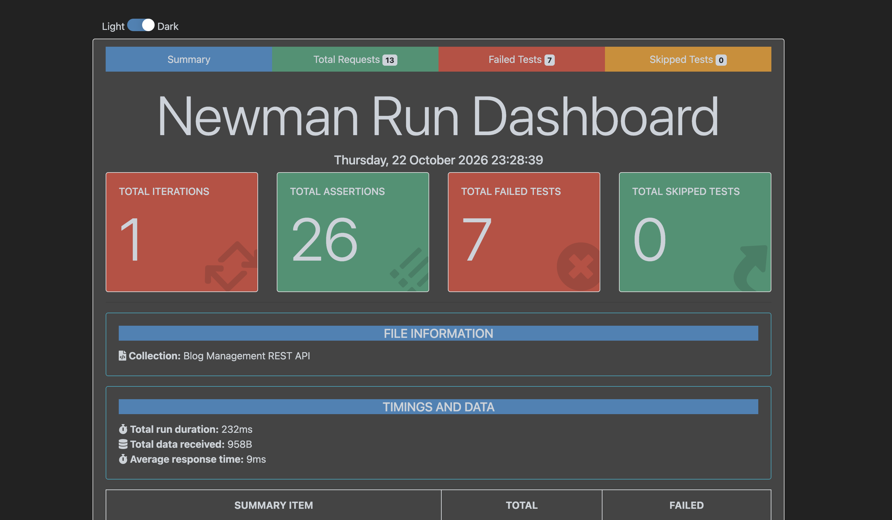

# Blog Management REST API

A REST API for managing users and blog posts, built with Node.js, Express, MySQL, and Sequelize. Public blog-reading endpoints do not require authentication. User and administrator endpoints require JWT authentication.

## Features

- User registration and login with JWT authentication and bcrypt password hashing
- Profile and password updates
- Admin user management, including account activation and deactivation
- Blog creation, listing, search, retrieval, updating, and deletion
- Ownership rules: users can update or delete their own posts; admins can manage any post
- Request validation with `express-validator`
- API testing with the included Postman collection and Newman

## Requirements

- Node.js 18 or later
- MySQL Server
- npm

## Installation and Setup

1. Clone the repository and enter the project directory:

   ```bash
   git clone https://github.com/tanvir17th/blog-api-management.git
   cd blog-api-management
   ```

2. Install dependencies:

   ```bash
   npm install
   ```

3. Create the database in MySQL. Sequelize creates the tables when the server starts, but the database must already exist:

   ```sql
   CREATE DATABASE blogdb;
   ```

4. Create a `.env` file from the example:

   ```bash
   cp .env.example .env
   ```

   Set your database credentials and replace `JWT_SECRET` with a long, unique secret:

   ```dotenv
   PORT=5000
   NODE_ENV=development
   DB_HOST=localhost
   DB_PORT=3306
   DB_NAME=blogdb
   DB_USER=root
   DB_PASSWORD=your_mysql_password
   JWT_SECRET=replace_with_a_long_random_secret
   JWT_EXPIRES_IN=1d
   ```

5. Start the development server:

   ```bash
   npm run dev
   ```

   The API is available at `http://localhost:5000` by default. Use `npm start` to start the server without `nodemon`. Set `PORT` in `.env` to use a different port.

## Authentication and Roles

Include the token returned by registration or login in the `Authorization` header when calling a protected endpoint:

```http
Authorization: Bearer <token>
```

New registrations receive the `user` role. The database supports `user` and `admin`; public endpoints do not require a separate guest account.

To promote an account to admin, register it first and then run this query in MySQL:

```sql
UPDATE users SET role = 'admin' WHERE email = 'admin@example.com';
```

Log in again after changing the role to receive a token for the updated account.

## API Endpoints

All endpoints are prefixed with `/api`. Protected endpoints require a bearer token.

| Method | Endpoint | Access | Description |
| --- | --- | --- | --- |
| `POST` | `/auth/register` | Public | Register with `firstname`, `lastname`, `email`, and `password` |
| `POST` | `/auth/login` | Public | Log in with `email` and `password` |
| `GET` | `/users/profile` | User, Admin | Get the authenticated user's profile |
| `PUT` | `/users/profile/update` | User, Admin | Update `firstname` and/or `lastname` |
| `PATCH` | `/users/password` | User, Admin | Change the authenticated user's password |
| `GET` | `users` | Admin | List all users |
| `GET` | `/users/:id` | Admin | Get a user by ID |
| `PATCH` | `/users/:id/status` | Admin | Set `isActive` to `true` or `false` |
| `POST` | `/blogs/create` | User, Admin | Create a blog with `blogTitle`, `blog`, and `category` |
| `GET` | `/blogs` | Public | List blogs; optionally filter by `title` and/or `category` |
| `GET` | `/blogs/:id` | Public | Get a blog by ID |
| `PUT` | `/blogs/update/:id` | User, Admin | Update a blog, subject to ownership rules |
| `DELETE` | `/blogs/delete/:id` | User, Admin | Delete a blog, subject to ownership rules |
| `DELETE` | `/blogs/:id` | User, Admin | Alias for deleting a blog by ID |

## Request Examples

Register a user:

```bash
curl -X POST http://localhost:5000/api/auth/register \
  -H 'Content-Type: application/json' \
  -d '{"firstname":"Ada","lastname":"Lovelace","email":"ada@example.com","password":"change-this-password"}'
```

Search blogs by title and category:

```bash
curl 'http://localhost:5000/api/blogs?title=express&category=technology'
```

Create a blog using a token returned by registration or login:

```bash
curl -X POST http://localhost:5000/api/blogs/create \
  -H 'Content-Type: application/json' \
  -H 'Authorization: Bearer <token>' \
  -d '{"blogTitle":"Getting started with Express","blog":"Post content goes here.","category":"technology"}'
```

## Postman and Newman

The Postman collection is available at `blog_management_api.postman_collection.json`. Start the API before running the collection and ensure its base URL points to your server.

Install Newman and its HTML reporter if needed:

```bash
npm install --global newman newman-reporter-htmlextra
```

Run the collection:

```bash
newman run blog_management_api.postman_collection.json
```

Run it with an HTML report:

```bash
newman run blog_management_api.postman_collection.json -r cli,htmlextra
```

## Project Structure

```text
├── config/          # Database connection
├── controllers/     # Request handlers
├── middleware/      # Authentication, validation, and error handling
├── models/          # Sequelize models and associations
├── routes/          # API routes
├── validators/      # Request validation rules
├── newman/          # Newman HTML reports
├── app.js           # Express application entry point
└── package.json
```

📷 **Execution Screenshot :**



## Author

**Md. Tanvir Ahamed**  
GitHub: [tanvir17th](https://github.com/tanvir17th)
